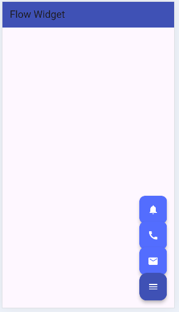

# Flow Widget Demo

**Flow** is a Flutter widget that lets you place and move its children yourself using a delegate, which makes it a good fit for animations like expanding menus.

## What my demo does

I made a small "quick actions" menu like the ones you see in a lot of apps. There is one menu button in the bottom right corner. When you tap it, three more buttons (mail, call and notifications) slide up above it. Tap the menu button again and they slide back down.

## How to run it

You need Flutter installed (I used Flutter with Dart ^3.13.2, check `pubspec.yaml`).

```
git clone https://github.com/pmganga/flow_widget.git
cd flow_widget
flutter pub get
flutter run
```

If you don't have a phone or emulator connected, you can run it in the browser with `flutter run -d chrome`.

## The three attributes

**1. `delegate`**
This is the main one. It takes a `FlowDelegate` (mine is `FlowMenuDelegate`) and inside `paintChildren` I decide where every child gets drawn. In my code each button moves up by `56 * index * animation.value`, so when the animation goes from 0 to 1 the buttons spread out. There is no default, you have to give it one. You would change it whenever you want a different layout, for example a fan or a circle instead of a straight line.

**2. `clipBehavior`**
The default is `Clip.hardEdge`, which cuts off anything drawn outside the Flow's box. My Flow is only 60x60 but the buttons move way outside of it, so with the default they get chopped off. I set it to `Clip.none` so you can see them. If you change it back to the default you can see the difference straight away.

**3. `children`**
The list of widgets that Flow lays out. The default is an empty list, `const <Widget>[]`, so with no children nothing is drawn. Mine are four `FloatingActionButton`s made from a list of icons. The order matters: index 0 is the menu button, and because I paint in reverse order it ends up on top of the others. If you reorder the list, the layout changes too.

## Screenshot



## Sources

- Flutter docs for Flow: https://api.flutter.dev/flutter/widgets/Flow-class.html
- (add any tutorial or video you followed here)

## What I learned

The hardest part was understanding that Flow only moves how things are painted, it does not change where they really are for touch. I also found out that the delegate needs `repaint: animation` or the buttons don't animate.

Presented in class on: 12/10/2026
